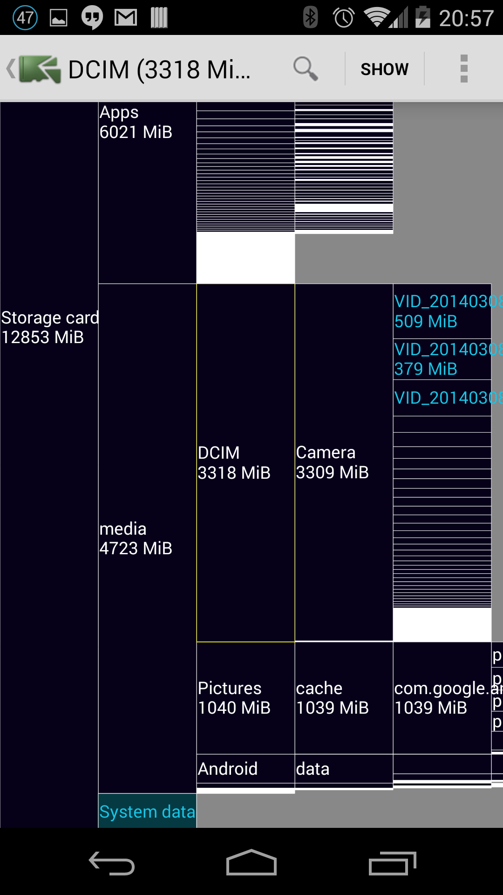
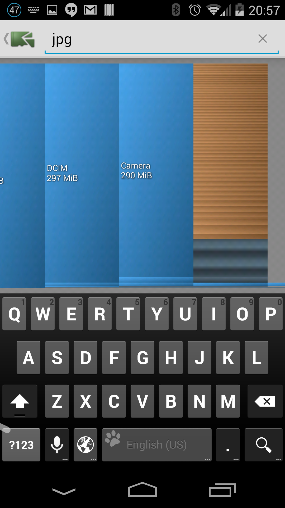

# DiskUsage

Find out what is eating your storage — and delete it.

[](https://github.com/bartman081523/diskusage/actions/workflows/ci.yml)
[](https://github.com/bartman081523/diskusage/actions/workflows/release.yml)
[](COPYING.txt)

DiskUsage is an Android storage analyser. Instead of a plain file list it draws a
map of your storage: every directory is a rectangle whose area is proportional to
the space it occupies, and several levels of subdirectories are shown at once.
Zoom into a region to see what is inside, then delete the big blocks to free up
space.

<p align="center">
  
  
</p>

## Features

* Visual map of internal storage, SD cards and USB drives
* Per-application breakdown into code, data and cache sizes
* Used / free space including the occupied percentage
* Search across the scanned tree
* Delete whole directories with a confirmation screen that lists the content
* Optional root support for any mounted file system
* Dark mode, adaptive and themed launcher icons, per-app language selection
* No ads, no tracking, no network permission

## Requirements

* Android 7.0 (API 24) or newer
* Android 17 (API 37) is the target SDK, so the app runs with the latest
  platform behaviour (edge-to-edge, 16 KB page sizes)

## Permissions

| Permission | Why |
|---|---|
| `MANAGE_EXTERNAL_STORAGE` (Android 11+) | Analysing the storage requires reading every directory. Without it only the app's own files are visible. |
| `READ/WRITE_EXTERNAL_STORAGE` (≤ Android 12) | Same purpose on older releases. |
| `PACKAGE_USAGE_STATS` (optional) | Exact per-app data/cache sizes via `StorageStatsManager`. The app still works without it, but only reports APK sizes. |
| `QUERY_ALL_PACKAGES` | Listing installed applications. |

No internet permission is requested, and the app contains no advertising or
analytics code.

## Install

* **F-Droid** — metadata is prepared in [`fastlane/metadata`](fastlane/metadata);
  submission is described in [docs/fdroid](docs/fdroid/README.md).
* **GitHub Releases** — every release contains a signed APK and `SHA256SUMS.txt`.
  See the [releases page](https://github.com/bartman081523/diskusage/releases).
* **Nightly builds** — the [nightly prerelease](https://github.com/bartman081523/diskusage/releases/tag/nightly)
  is rebuilt every day from `main`. It is debug-signed, don't mix it with a
  release installation.

## Build

```bash
# JDK 17+, Android SDK with platform 37.0, build-tools 36.0.0 and NDK r28c
export ANDROID_HOME=$HOME/Android/Sdk
./gradlew assembleDebug        # app/build/outputs/apk/debug/
./gradlew testDebugUnitTest    # JVM unit tests
./gradlew lintDebug            # Android Lint
./gradlew assembleRelease      # unsigned release APK unless a keystore is configured
```

Local release builds read `keystore.properties` from the repository root:

```properties
storeFile=/absolute/path/to/release.jks
storePassword=…
keyAlias=…
keyPassword=…
```

The file is git-ignored. CI uses `RELEASE_KEYSTORE_BASE64` plus
`RELEASE_KEYSTORE_PASSWORD`, `RELEASE_KEY_ALIAS` and `RELEASE_KEY_PASSWORD`
secrets instead; see [docs/RELEASING.md](docs/RELEASING.md).

## Project layout

| Path | Contents |
|---|---|
| `app/src/main/java/.../core` | Native (C) scanner and the Java fallback scanner |
| `app/src/main/java/.../datasource` | Storage access abstraction (files, package stats) |
| `app/src/main/java/.../filesystem` | Volume discovery, app loader, deletion |
| `app/src/main/java/.../opengl`, `ui` | Rendering threads and activities |
| `app/src/main/jni` | `libscan.so`, the `ndk-build` tree walker, called through JNI |
| `fastlane/metadata` | Store/F-Droid metadata (icon, screenshots, descriptions) |
| `docs` | Release process, F-Droid submission, issue triage |

## Versioning

`version.properties` is the single source of truth. `versionCode` is derived from
the semantic version (`5.1.2` → `50102`). Tags are `v<versionName>`.

```bash
./scripts/bump-version.sh patch   # 5.0.0 -> 5.0.1
```

## Contributing

Bug reports and pull requests are welcome. Please read
[CONTRIBUTING.md](CONTRIBUTING.md) first.

## License

DiskUsage is free software, licensed under the GNU General Public License
version 2 or later. See [COPYING.txt](COPYING.txt).

The project started as [IvanVolosyuk/diskusage](https://github.com/IvanVolosyuk/diskusage);
this repository continues it with a modern build toolchain and current Android
support.
